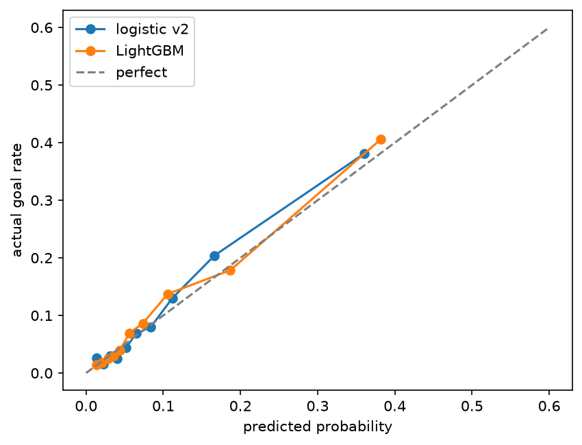
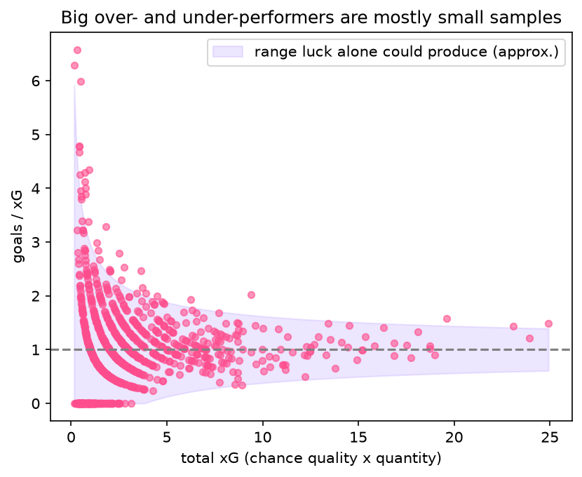
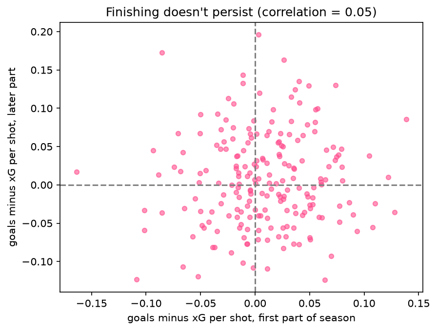

# Soccer Goal Probability (xG) Model

Estimates the probability that a soccer shot becomes a goal, then asks whether individual players finish better or worse than those chances predict. Built with free [StatsBomb open data](https://github.com/statsbomb/open-data).

**Short version:** the shot model beats a naive baseline, is well calibrated, and holds up on competitions it never saw. Player finishing skill, on the other hand, is too small to detect in a single season of data.

## Project structure

| File | What it does |
|---|---|
| `xg_model.ipynb` | Notebook 1: builds and validates the shot-probability (xG) model |
| `02_finishing_skill.ipynb` | Notebook 2: tests player finishing skill with shrinkage |
| `images/` | Plots used in this README |
| `data/` | Cached StatsBomb downloads (not uploaded to GitHub) |

---

## Part 1: The xG model

### Approach
- **Data:** 2015/16 Premier League, La Liga, Serie A and Ligue 1 (about 37,500 non-penalty shots), plus World Cup 2018 and Bundesliga samples used only as a stress test
- **Features:** distance, angle, header, defenders in the shot cone, goalkeeper distance, under pressure, first-time shot, one-on-one
- **Models:** logistic regression and LightGBM, compared to a constant-probability baseline
- **Validation:** trained on earlier matches, tested on later ones, then stress-tested on competitions never seen in training

### Results (log loss, lower is better)

| Model | Later league matches | World Cup + Bundesliga |
|---|---|---|
| Baseline (same chance for every shot) | 0.326 | 0.313 |
| Logistic regression v2 | 0.271 | 0.270 |
| LightGBM | 0.265 | 0.262 |

Dots near the dashed line mean the probabilities are honest: when the model says 30%, about 30% of those shots score.

---

## Part 2: Does finishing skill exist?

The xG model measures the quality of the chance, not the quality of the shooter. To test shooter skill, each shot gets an out-of-sample xG (the model never saw that match), and every player's goals are compared with their expected goals.

**Sanity check:** across the four leagues, 3,569 actual goals vs. 3,568.5 total xG.

### Why shrinkage

Goals are rare, so a player with a few lucky goals can look like a superstar. Shrinkage pulls each player toward "average finisher" (1.0), and pulls harder when there is less data:

`skill = (alpha + goals) / (alpha + xG)`

Alpha is estimated from the data: it measures how much real skill variation exists beyond luck.

### Results

| Method (predicting goals in the later part of the season) | Error (lower is better) |
|---|---|
| xG only (everyone average) | 2.565 |
| Raw goals / xG | 3.559 |
| Shrunk skill | 2.563 |

- Using raw goals/xG is far **worse** than ignoring finishing entirely, because hot streaks do not repeat.
- Shrunk skill ties with plain xG: the estimated alpha was about 7 million, meaning the model found no detectable variation in finishing ability, so everyone collapses to average.
- Early-season over/under-performance correlates with later-season performance at only **0.05** (204 players).

### What this does and does not mean
- **It means:** in one season, goals-minus-xG is mostly luck, and the biggest outliers are small samples.
- **It does not mean:** finishing skill does not exist. Published work finds small effects for elite players, but it takes several seasons of shots to see them.

---

## Limitations
- Bundesliga open data covers only Bayer Leverkusen's matches
- Penalties are excluded (a different problem)
- The xG model does not know who is shooting
- One season of league data is too little to detect small finishing differences
- LightGBM's edge over logistic regression is small (about 0.006 log loss)

## Next steps
- Player impact on team xG (RAPM-style) as a route to substitution what-ifs
- Hockey version to test the multi-sport pipeline

## How to run
1. Create an environment and install: `pip install statsbombpy pandas numpy scikit-learn lightgbm matplotlib scipy`
2. Open `xg_model.ipynb` and run the cells in order. The first run downloads the data (about an hour for the four leagues) and saves it to `data/`.
3. At the end of notebook 1, save the processed shots with `shots.to_pickle("data/shots_features.pkl")`, which notebook 2 loads.
4. On Mac, LightGBM may need `conda install -c conda-forge llvm-openmp`.
